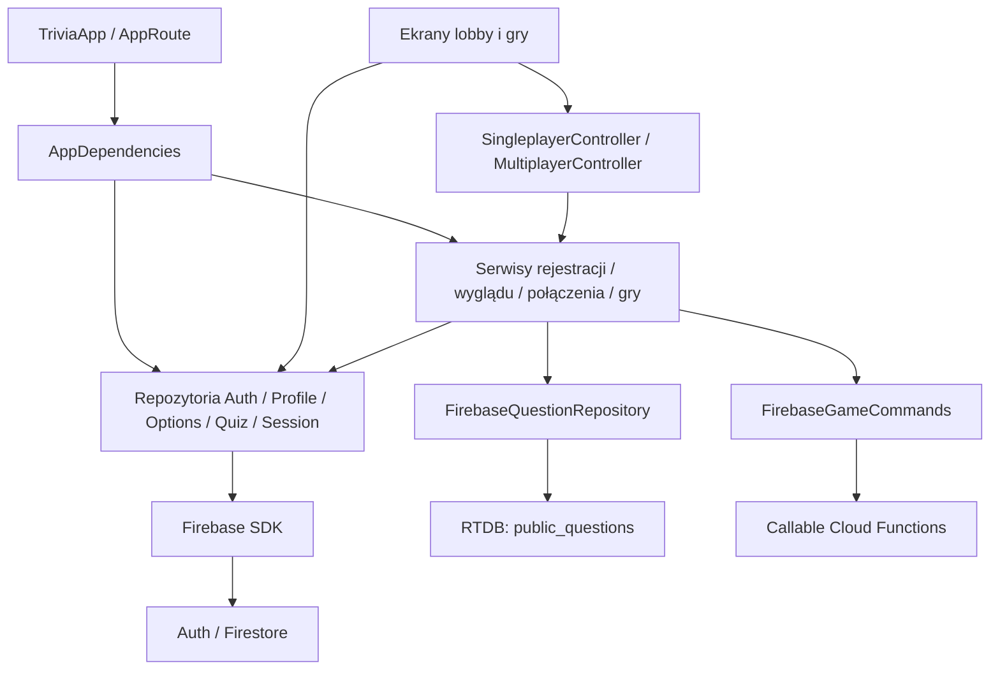
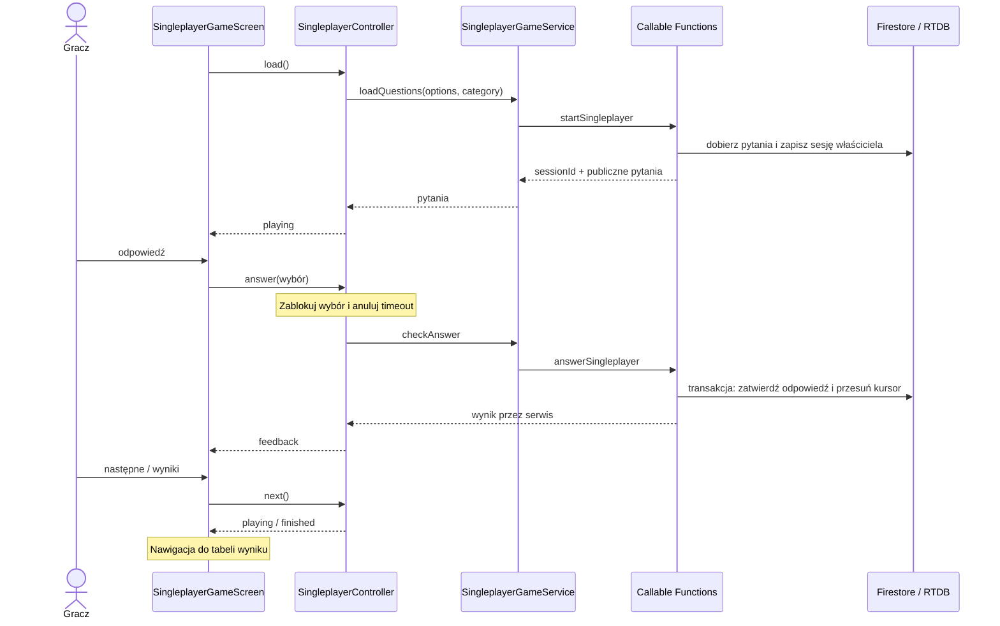

# Architektura po refaktorze

Stan kodu po etapach 6–8. Diagramy przedstawiają aktywne przepływy; nie oznaczają zaliczenia prób chmurowych ani wdrożenia.

## Zależności klienta



Kontrolery nie otrzymują `BuildContext`. Nawigacja i SnackBary pozostają w ekranach, zegary logiki są w kontrolerach, a animacje w widgetach. `SessionRepository` zwraca `SessionSnapshot`; mapy dokumentów są interpretowane na granicy repozytorium w modelu snapshotu. Repozytorium Auth zwraca dane aplikacji zamiast obiektu SDK.

Nie każdy ekran potrzebuje serwisu. Lista quizów, profil i opcje korzystają bezpośrednio z kontraktów repozytoriów. Zachowane serwisy koordynują operacje: rejestracja Auth/profilu, preset/opcje, dobór/dołączenie do lobby oraz sesja gry. Usuniętych warstw delegujących nie ma w tym diagramie.

## Singleplayer



Timeout wywołuje tę samą ścieżkę z pustą odpowiedzią. Po utracie odpowiedzi sieciowej kontroler ponawia ten sam wybór. Wynik lokalny zmienia się dopiero po potwierdzeniu serwera.

## Lobby publiczne i prywatne

```mermaid
sequenceDiagram
  participant UI as Lobby
  participant Conn as MultiplayerConnectionService
  participant Repo as SessionRepository
  participant F as Callable Functions
  participant Model as SessionSnapshot
  UI->>Conn: connectPlayer(settings)
  Conn->>Repo: znajdź / utwórz / dołącz
  Repo->>F: komenda z tożsamością Auth
  F-->>UI: sessionId przez repozytorium i serwis
  UI->>Repo: sessionDocStream(sessionId)
  Repo->>Model: sparsuj dokument
  Model-->>UI: typowany snapshot
  Note over F: Publiczna gra startuje po zapełnieniu lobby; prywatną uruchamia gospodarz
  Repo-->>UI: inProgress
  Note over UI: Oznacz przejście do gry; dispose lobby nie wysyła wyjścia
  UI->>UI: pushReplacementNamed z MultiplayerGameArguments
```

Prywatny gość dołącza przez `SessionRepository`; gospodarz może zapisywać ustawienia i uruchomić oczekującą grę. Serwer weryfikuje kod, uprawnienia i stan sesji. Rozłączenie sieciowe nie jest automatycznie komendą opuszczenia gry.

## Rundy i wyniki multiplayera

```mermaid
sequenceDiagram
  participant UI as MultiplayerGameScreen
  participant C as MultiplayerController
  participant S as MultiplayerGameService
  participant Repo as SessionRepository
  participant F as Functions / lifecycle
  participant Q as Cloud Tasks
  participant DB as Firestore / RTDB
  C->>S: buildLiveGameStateStream()
  S->>Repo: typowane snapshoty
  Repo-->>C: LiveGameState przez serwis
  UI->>C: answer(wybór)
  C->>S: submitAnswer
  S->>Repo: komenda odpowiedzi
  Repo->>F: submitMultiplayerAnswer
  F->>DB: walidacja i atomowa blokada odpowiedzi
  F-->>C: wynik przez repozytorium i serwis
  F->>Q: zadania timeout / advance
  Q->>F: dostarcz zadanie; ponów po błędzie
  F->>DB: odczytaj świeży stan i rozstrzygnij rundę
  DB-->>C: resolving / następne answering przez strumień
  F->>DB: atomowo: archiwum, statystyki, resultsReady
  DB-->>C: finished + resultsReady przez strumień
  C->>S: fetchFinalSessionData()
  S->>Repo: fetchArchivedSession()
  Repo-->>C: MultiplayerSessionData
  C-->>UI: finalSession
  Note over UI: Nawigacja z MultiplayerScoreArguments
  F->>Q: cleanup
  Q->>F: usuń dane robocze; zachowaj archiwum
```

Historyczny uczestnik zachowuje dostęp do archiwum. Jeśli dokument sesji już nie istnieje, repozytorium tworzy zakończony snapshot z rozliczonego archiwum. Samo `finished` bez `resultsReady` nie uruchamia nawigacji. Kontroler ignoruje wyniki operacji z poprzedniej rundy i po `dispose`.

Diagramy z `docs/zadanie4` pozostają materiałem historycznym. Nie są aktualnym kontraktem klas, protokołu ani zabezpieczeń.
